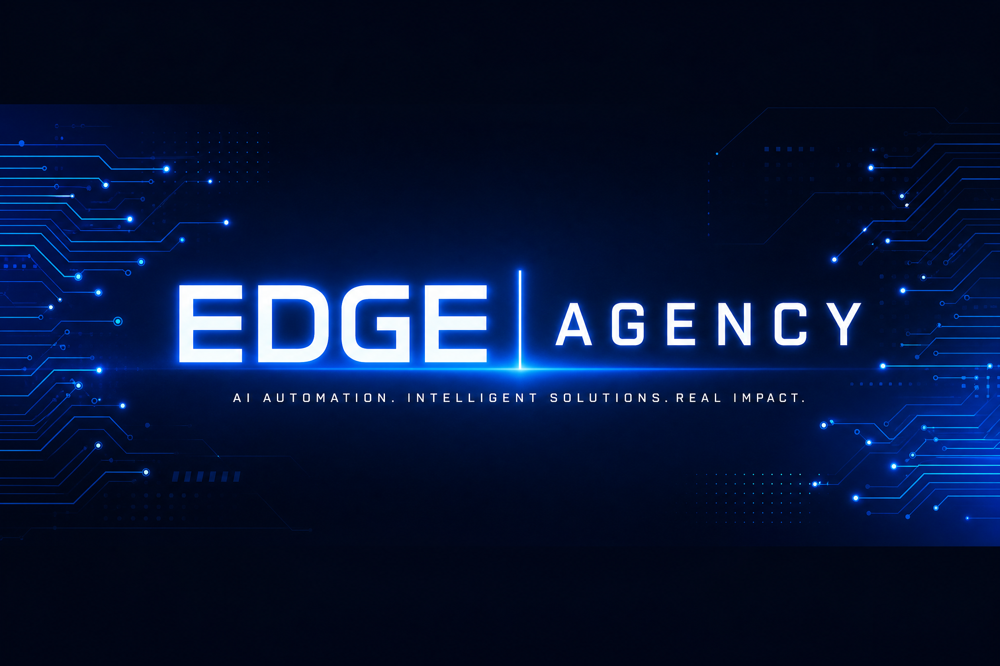
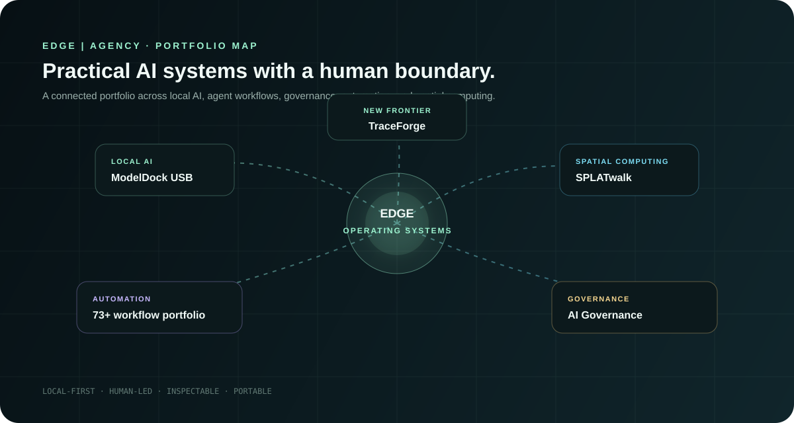

# Kevin Doherty

### Founder, product builder, and AI systems engineer at EDGE | AGENCY

> I build practical AI products, agent systems, automation workflows, secure developer tools, and focused interfaces that move from idea to working system.

## Edge Atlas

**[Edge Atlas](https://github.com/EdgeAgent/crypto-trade-pro)** is my repository of repositories: a source-linked workspace for projects, AI frameworks, and prompt skills. It is the clearest starting point for exploring the systems, experiments, interfaces, and research collected across this profile.

The catalog favors honest metadata over made-up rankings. Each record points back to its source, preserves missing or unavailable information, and separates the broader AI workspace from the optional CryptoTrade Pro trading route.

## What I build

| Focus | Selected work |
| --- | --- |
| **AI agents and operator systems** | [JARVIS Neural Console](https://github.com/EdgeAgent/jarvis-neural-console), [JARVIS Department Agent](https://github.com/EdgeAgent/jarvis-department-agent), [BuizAgents](https://github.com/EdgeAgent/buizagents-4754), [ClawPilot](https://github.com/EdgeAgent/clawpilot-command-center) |
| **Frameworks and governed execution** | [TraceForge](https://github.com/EdgeAgent/traceforge), [Warrantly](https://github.com/EdgeAgent/warrantly), [DSER Agent Framework](https://github.com/EdgeAgent/dser-agent-framework), [Swarms on Edge](https://github.com/EdgeAgent/swarms-on-edge) |
| **Automation and prompt libraries** | [n8n Automations](https://github.com/EdgeAgent/n8n-automations), [GHL Pro MCP](https://github.com/EdgeAgent/ghl-pro-mcp), [Edge Automation Portfolio](https://github.com/EdgeAgent/edge-automation-portfolio) |
| **Secure developer tools** | [Threadlight](https://github.com/EdgeAgent/threadlight-chrome-extension), [Client API Vault Relay](https://github.com/EdgeAgent/client-api-vault-relay-chrome-extension), [API Scout](https://github.com/EdgeAgent/api-scout) |
| **Research and trading intelligence** | [QuantumSignal Engine](https://github.com/EdgeAgent/quantum-signal-engine), [CryptoTrade Pro](https://github.com/EdgeAgent/crypto-trade-pro), [TradeOS](https://github.com/EdgeAgent/TradeOS) |

## How I work

I care about the boundary between an impressive demo and a dependable product. My builds tend to include explicit states, source attribution, scoped integrations, reviewable actions, audit trails, and documentation that explains what is real, what is unavailable, and what remains experimental.

I use AI as a building material, not a substitute for product judgment. The goal is a system that people can understand, test, operate, and improve.

## Start here

- **Browse the [Edge Atlas repository](https://github.com/EdgeAgent/crypto-trade-pro)** for the full source-linked collection.
- **Explore [all public repositories](https://github.com/EdgeAgent?tab=repositories)** across agents, frameworks, automation, tools, and research.

> **Research and trading boundary:** trading-related repositories are research, analytics, paper-trading, simulation, and product-development work. They are not investment advice, performance claims, or a recommendation to trade.
