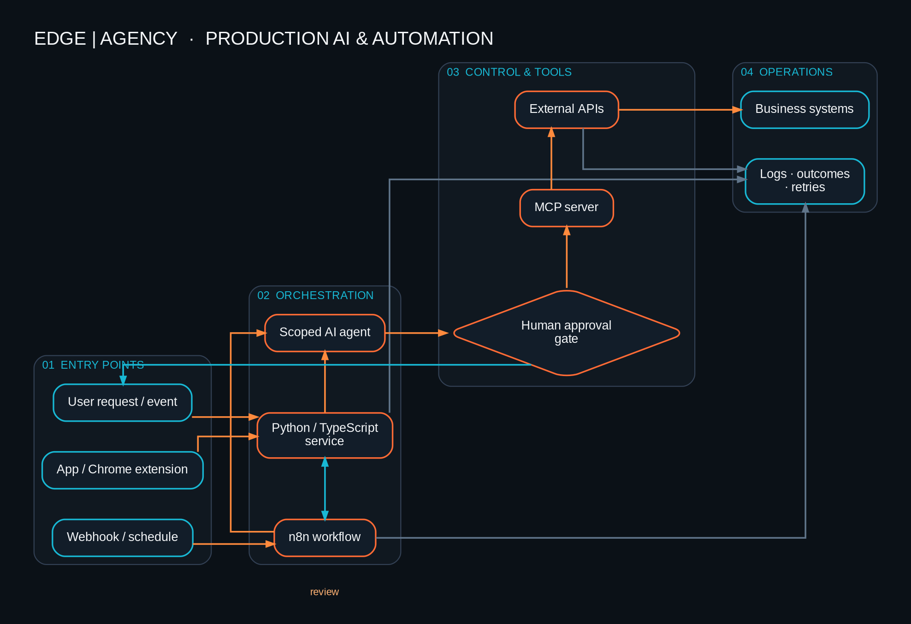
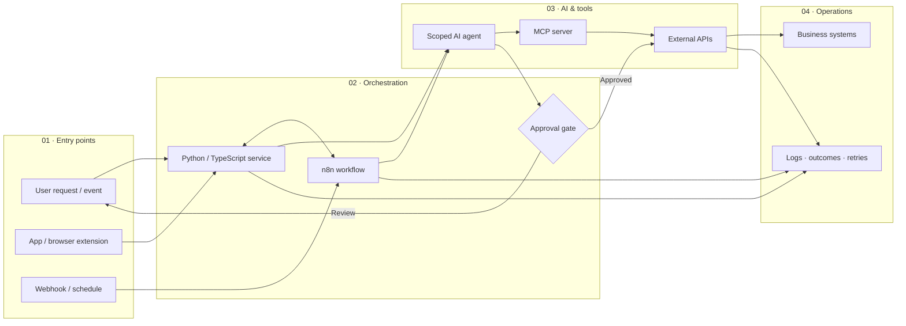

  

<h1 align="center">Kevin Doherty</h1>
<h3 align="center">AI Systems Engineer &amp; Automation Architect · EDGE | AGENCY</h3>

  <a href="https://edgeagency.pro">Portfolio</a> ·
  <a href="https://github.com/EdgeAgent?tab=repositories">GitHub Projects</a> ·
  <a href="https://edgeagency.pro">Contact</a>

  
  
  

I build production AI and automation systems. My work connects agents, APIs, and business operations across **multi-agent orchestration, n8n workflows, MCP servers, developer productivity tools, and full-stack applications**—with a focus on clear interfaces, bounded actions, and systems people can understand and operate.

I’m interested in **AI Automation Engineer, Solutions Engineer, and Developer Productivity Engineer** roles. I bring product-minded engineering from problem framing through implementation, integration, and documentation.

## Technology toolkit

  
  
  
  
  
  
  
  
  
  

**Core strengths:** agent and workflow architecture · REST APIs and webhooks · MCP tool interfaces · human-in-the-loop controls · secure browser tooling · service integration · CI/CD · technical documentation.

## Selected work

| Project | Overview | Stack / focus |
| --- | --- | --- |
| [JARVIS Department Agent](https://github.com/EdgeAgent/jarvis-department-agent) | FastAPI agent service with bounded department managers, approval gates, n8n contracts, and local voice-response support. | Python · FastAPI · AI agents · n8n |
| [EDGE Automation Portfolio](https://github.com/EdgeAgent/edge-automation-portfolio) | 73+ categorized n8n workflow blueprints covering lead generation, real estate, e-commerce, content, service, and integrations. | n8n · APIs · webhooks · workflow design |
| [Flagship n8n Automations](https://github.com/EdgeAgent/EDGE-AGENCYAutomations-n8n) | Documented examples for AI-assisted content, executive assistance, video workflows, and SDR lead qualification. | n8n · OpenAI · SaaS integrations |
| [GHL Pro MCP](https://github.com/EdgeAgent/ghl-pro-mcp) | MCP server connecting AI tools to GoHighLevel CRM workflows and analytics. | MCP · APIs · CRM |
| [Client API Vault Relay](https://github.com/EdgeAgent/client-api-vault-relay-chrome-extension) | Manifest V3 extension with a locally encrypted API vault, exact-origin approval, and source-attributed provider discovery. | TypeScript/JavaScript · Chrome · security |
| [API Scout](https://github.com/EdgeAgent/api-scout) | Local-first catalog and CLI for discovering free APIs and free-tier LLM providers. | Developer tooling · APIs · local-first |

## System design

I favor clear boundaries over opaque “magic”: an explicit entry point, a scoped orchestrator, narrowly defined agent and tool capabilities, and an approval checkpoint where actions need human judgment. Integrations use stable contracts, and logs capture outcomes for debugging and handoff.

  

<strong>Architecture source (Mermaid)</strong>

## Getting started with the projects

- **n8n workflows:** clone the [portfolio](https://github.com/EdgeAgent/edge-automation-portfolio), select a workflow under `workflows/`, import its JSON into n8n, configure the required credentials in n8n’s credential manager, then test with representative data before activation.
- **Flagship automations:** clone [EDGE-AGENCYAutomations-n8n](https://github.com/EdgeAgent/EDGE-AGENCYAutomations-n8n), choose a documented workflow, import the JSON, configure only its required integrations, and validate triggers and approval steps before enabling production runs.
- **Agent service:** use the [JARVIS Department Agent README](https://github.com/EdgeAgent/jarvis-department-agent) for environment setup and local run instructions; it documents the service-specific requirements.

Keep secrets in environment configuration or the platform’s credential store—never in committed workflow exports. Validate API permissions, failure handling, and review gates in a test environment before connecting live systems. Project-specific runtime and deployment instructions remain authoritative in each repository.

## Engineering principles

**Inspectable by default.** I aim to make capabilities, assumptions, and system boundaries visible. Practical delivery means a reproducible setup, scoped integrations, useful error handling, clear docs, and appropriate human review—not just an impressive demo.

---

EDGE | AGENCY · Practical AI systems, thoughtful automation, better developer workflows.

