<h1 align="center">Kevin Doherty</h1>
<h3 align="center">AI Systems Engineer &amp; Automation Architect · EDGE | AGENCY</h3>

  <a href="https://edgeagency.pro">Portfolio</a> ·
  <a href="https://github.com/EdgeAgent?tab=repositories">GitHub Projects</a> ·
  <a href="https://edgeagency.pro">Contact</a>

  
  
  

I build production AI and automation systems. My work connects agents, APIs, and business operations across **multi-agent orchestration, n8n workflows, MCP servers, developer productivity tools, and full-stack applications**—with a focus on clear interfaces, bounded actions, and systems people can understand and operate.

I’m interested in **AI Automation Engineer, Solutions Engineer, and Developer Productivity Engineer** roles. I bring product-minded engineering from problem framing through implementation, integration, and documentation.

## Technology toolkit

  
  
  
  
  
  
  
  
  
  

**Core strengths:** agent and workflow architecture · REST APIs and webhooks · MCP tool interfaces · human-in-the-loop controls · secure browser tooling · service integration · CI/CD · technical documentation.

## Automation in production

The work that's actually running, not just built:

| System | What it does every day | Proof |
| --- | --- | --- |
| [Hermes Lead Engine](https://agencylead.ca) | Governed outreach for AgencyLead.ca: business discovery, dedup and never-contact scrub checks enforced in code before every send, over Cloudflare's email API. | 50 sends/day hard cap · zero duplicate sends since the gate went in |
| [n8n Workflow Portfolio](https://github.com/EdgeAgent/edge-automation-portfolio) | Production n8n blueprints: lead capture and enrichment, CRM follow-up, content operations — importable workflows with credentials kept in n8n, never in the exports. | Curated from live client-style builds |
| [GHL Pro MCP](https://github.com/EdgeAgent/ghl-pro-mcp) | Lets AI tools run GoHighLevel CRM work — lead scoring, pipeline analytics, workflow triggers — through one MCP server. | Working MCP server, public repo |

## Project map

  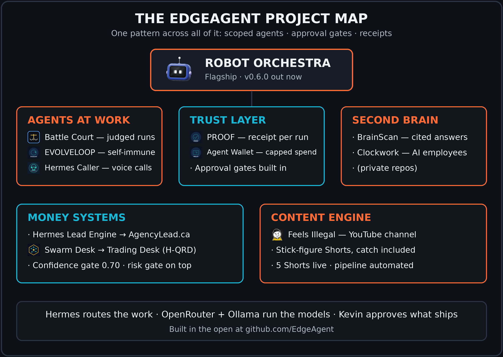

## Selected work

| Project | Overview | Stack / focus |
| --- | --- | --- |
| [Robot Orchestra](https://github.com/EdgeAgent/robot-orchestra) | Local-first Windows multi-agent desktop copilot: a floating robot head (Roboto) delegates to agents working in their own watchable sandbox screens. v0.6.0 released — 66 release downloads so far. [Download](https://github.com/EdgeAgent/robot-orchestra/releases/latest) · [getrobotorchestra.com](https://getrobotorchestra.com) | Electron · React/TypeScript · Ollama · Hermes/OpenRouter |
| [AI Rollout Pack](https://github.com/EdgeAgent/ai-rollout-pack) | The adoption layer: put an AI employee to work inside a small business — lane one-pagers, a governance sheet with approval gates and a kill switch, a staff guide, and a zero-dependency CLI that scaffolds the whole rollout and lints it against 7 governance rules. Fully worked fictional example plus a sanitized case study of the real pattern. 21/21 tests passing. | Python · Templates · Governance |
| [Swarm Desk](https://github.com/EdgeAgent/swarm-desk) | A 9-persona agent swarm that debates a stock from bull, bear, quant and sentiment seats and returns one confidence score for a trading desk's 0.70 catalyst gate. Every prediction is written to an experiment ledger and scored against what actually happened. Plugs into any agent via MCP, HTTP or Python. v0.1.1 released. First live test: 12 predictions frozen on Nov 5, 2026, scored against the real market a week later · 30/30 tests passing. | Python · MCP · Multi-agent systems |
| [Battle Court](https://github.com/EdgeAgent/multi-cli-framework) | Multi-CLI agent framework: parallel coding agents work in isolated sandboxes and a Verdict Layer judges the results — winners are staged for human approval, never auto-merged or shipped. 61/61 tests passing. | Python · Agent orchestration · Evaluation |
| [EVOLVELOOP](https://github.com/EdgeAgent/evoloop-framework) | Self-immune agent framework: failures become antibodies (tests and guards), and the system evolves one human-approved rule change per cycle around an immutable safety core. 38 tests passing. | Python · Agent safety · Testing |
| [Hermes Caller](https://github.com/EdgeAgent/hermes-caller-framework) | Agent-phone cold-calling framework: scrub/DNC filtering first, approval-gated call packets, scripted outreach and wholesale modes. 65 tests passing. | Python · Voice agents · Compliance gates |
| [PROOF](https://github.com/EdgeAgent/agent-proof-framework) | The agent receipt layer: every agent run produces a hash-chained, verifiable proof of what it did, what it touched, and what it returned. 6/6 tests passing. | Python · Provenance · Audit |
| [Agent Wallet](https://github.com/EdgeAgent/agent-wallet-framework) | A spending wallet for agent frameworks: per-spend and daily caps, a kill switch, and funding intents only — agents propose spend, humans fund it. Hard caps: $25 per spend, $100 per day · 12/12 tests passing. | Python · Agent safety · Payments |
| [WRECK](https://github.com/EdgeAgent/WRECK) | Web Reverse Engineering & Cloning Kit — an extensible, evidence-first toolkit for studying how websites work under the hood. | Developer tooling · Web research |
| [Hermes Lead Engine · AgencyLead.ca](https://agencylead.ca) | Production lead pipeline behind AgencyLead.ca: business discovery, dedup and never-contact scrub enforcement, verified outreach sends, and a 50/day governed cap enforced before every send. *(Private client system.)* | Python · Cloudflare · Lead generation |
| [BrainScan](https://github.com/EdgeAgent/BrainScan) | Auto-scanning second brain: watches your documents, answers with citations, or refuses. *(Private.)* | Python · Qdrant · Docling · FastAPI · RAG |
| [Clockwork](https://github.com/EdgeAgent/Clockwork) | AI employee framework: clocks in on its own, gathers context, memory and skills, waits for approval, executes, checks, and remembers. *(Private.)* | Python · CLI · SQLite · Agent framework |
| [Feels Illegal](https://www.youtube.com/@FeelsIllegalMoney) | AI content pipeline and YouTube channel: stick-figure Shorts that break down money plays and name the catch — script, local AI voice, animated scenes, published with full SEO packs. Five Shorts live. | Python · FFmpeg · AI video |
| [Lead Automation Platform Case Study](https://github.com/EdgeAgent/lead-automation-platform-case-study) | Sanitized case study of event-driven lead capture, payment verification, CRM enrichment, outreach, and operations reporting. | Cloudflare Workers · Python · REST APIs · Webhooks |
| [GHL Pro MCP](https://github.com/EdgeAgent/ghl-pro-mcp) | MCP server connecting AI tools to GoHighLevel CRM workflows, lead scoring, and analytics. | MCP · APIs · CRM |
| [API Scout](https://github.com/EdgeAgent/api-scout) | Local-first catalog and CLI for discovering free APIs and free-tier LLM providers. | Developer tooling · APIs · local-first |

## Project gallery

<table>
  <tr>
    <td width="50%"><a href="https://github.com/EdgeAgent/robot-orchestra">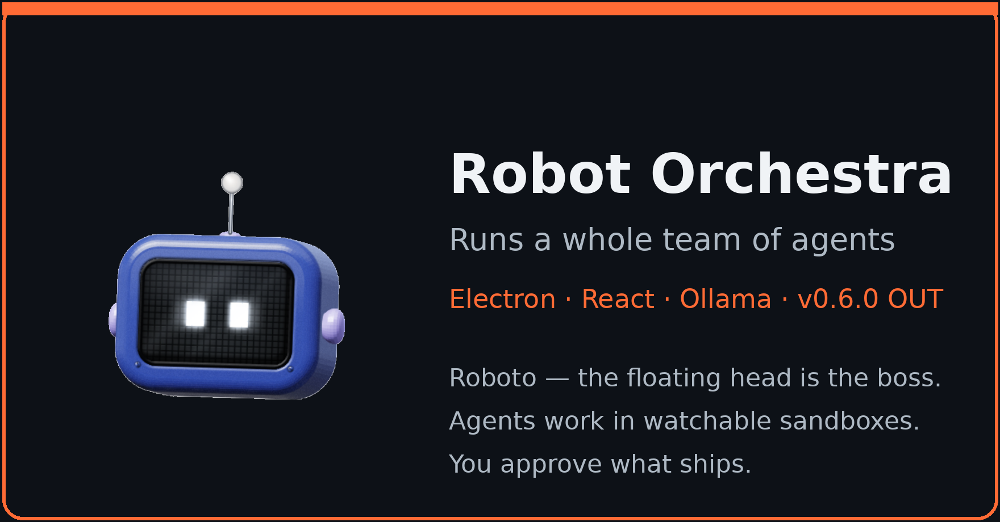</a></td>
    <td width="50%"><a href="https://github.com/EdgeAgent/swarm-desk">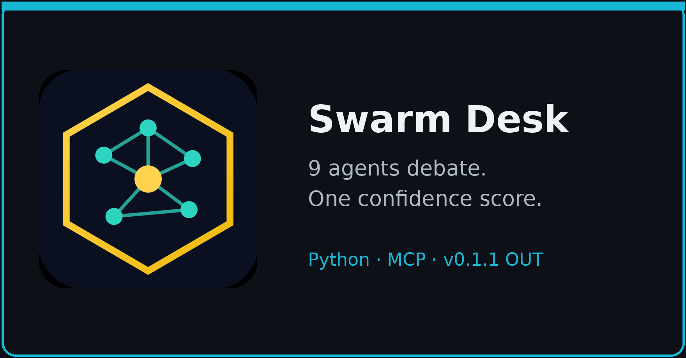</a></td>
  </tr>
  <tr>
    <td><a href="https://github.com/EdgeAgent/multi-cli-framework">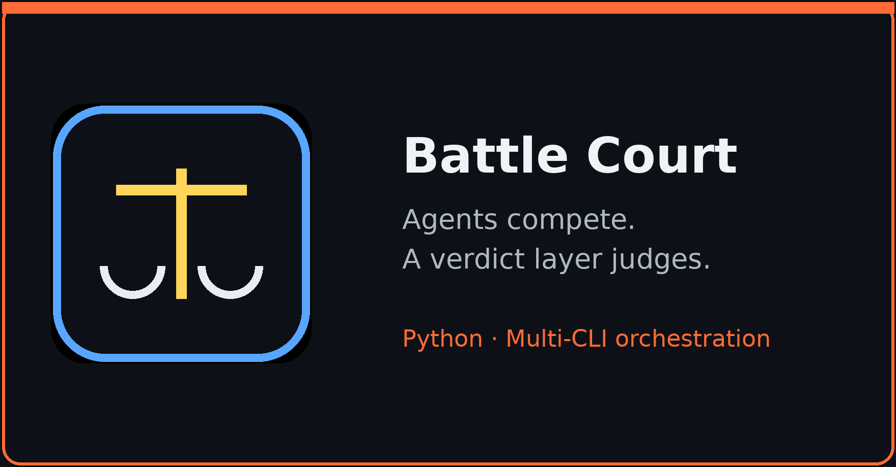</a></td>
    <td><a href="https://github.com/EdgeAgent/evoloop-framework">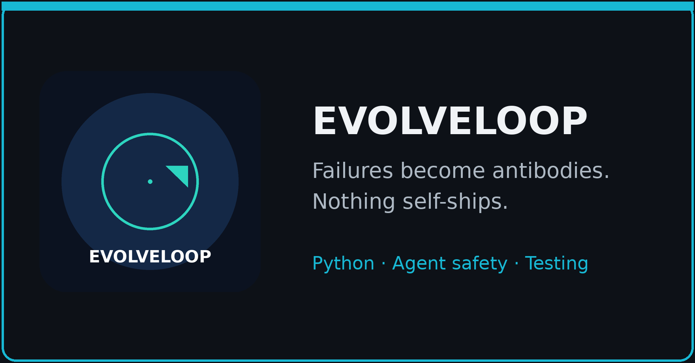</a></td>
  </tr>
  <tr>
    <td><a href="https://github.com/EdgeAgent/hermes-caller-framework">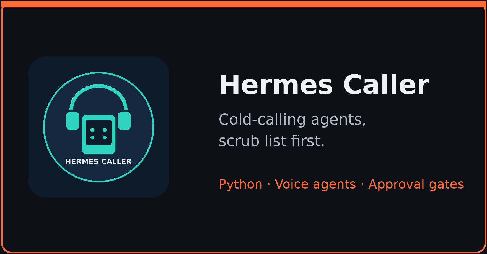</a></td>
    <td><a href="https://github.com/EdgeAgent/agent-proof-framework">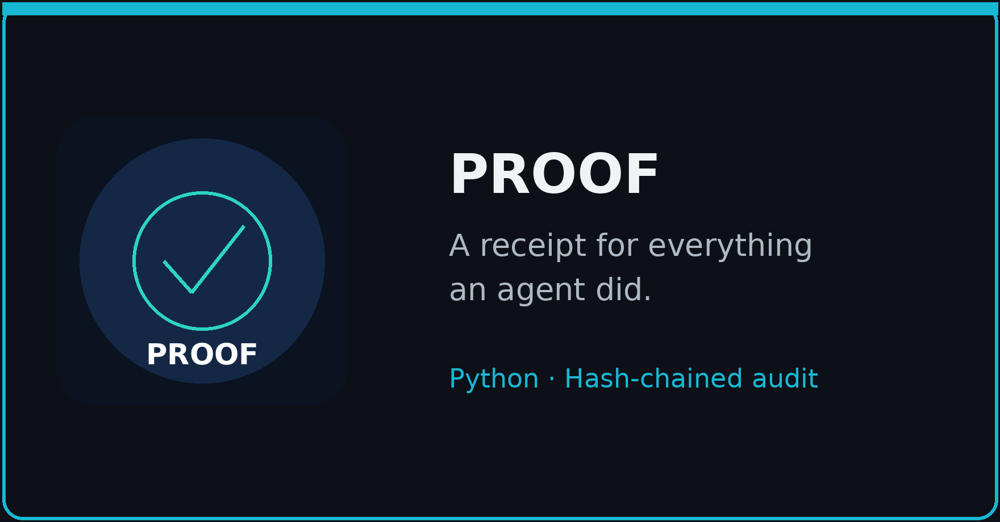</a></td>
  </tr>
  <tr>
    <td><a href="https://github.com/EdgeAgent/agent-wallet-framework">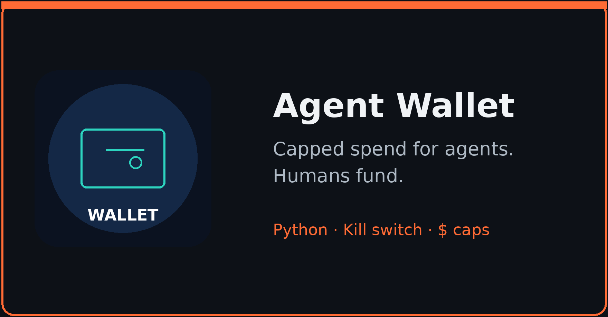</a></td>
    <td><a href="https://www.youtube.com/@FeelsIllegalMoney">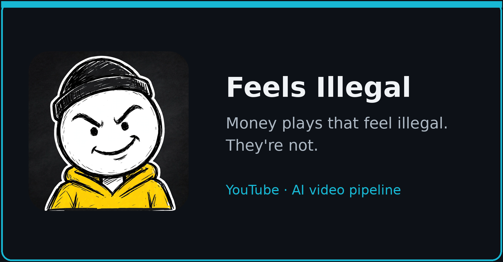</a></td>
  </tr>
</table>

## System design

I favor clear boundaries over opaque “magic”: an explicit entry point, a scoped orchestrator, narrowly defined agent and tool capabilities, and an approval checkpoint where actions need human judgment. Integrations use stable contracts, and logs capture outcomes for debugging and handoff.

  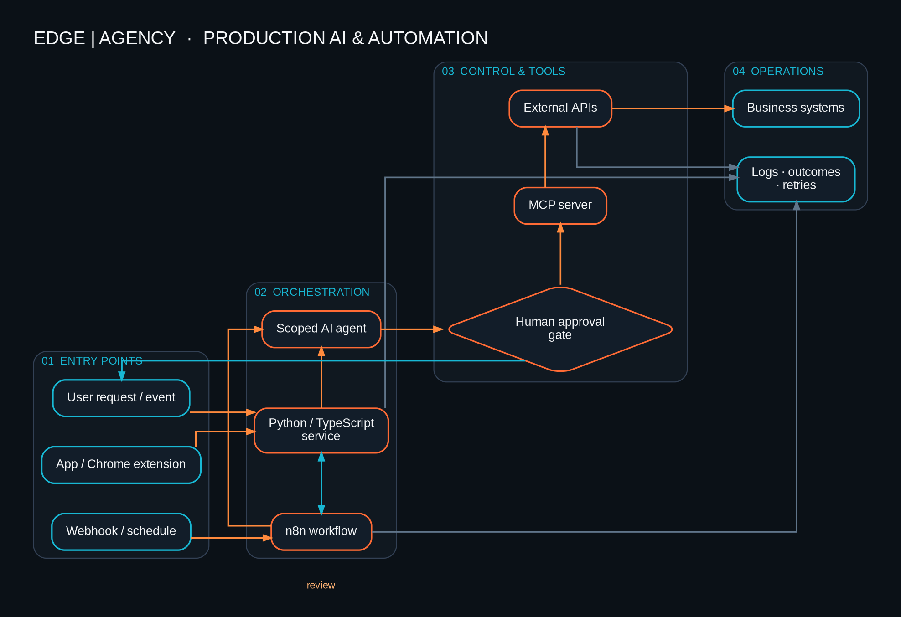

<strong>Architecture source (Mermaid)</strong>

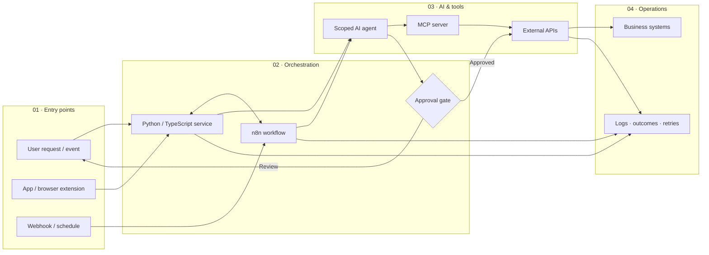

## Getting started with the projects

- **n8n workflows:** clone the [portfolio](https://github.com/EdgeAgent/edge-automation-portfolio), select a workflow under `workflows/`, import its JSON into n8n, configure the required credentials in n8n’s credential manager, then test with representative data before activation.
- **Flagship automations:** clone [EDGE-AGENCYAutomations-n8n](https://github.com/EdgeAgent/EDGE-AGENCYAutomations-n8n), choose a documented workflow, import the JSON, configure only its required integrations, and validate triggers and approval steps before enabling production runs.
- **Agent service:** use the [JARVIS Department Agent README](https://github.com/EdgeAgent/jarvis-department-agent) for environment setup and local run instructions; it documents the service-specific requirements.

Keep secrets in environment configuration or the platform’s credential store—never in committed workflow exports. Validate API permissions, failure handling, and review gates in a test environment before connecting live systems. Project-specific runtime and deployment instructions remain authoritative in each repository.

## Engineering principles

**Inspectable by default.** I aim to make capabilities, assumptions, and system boundaries visible. Practical delivery means a reproducible setup, scoped integrations, useful error handling, clear docs, and appropriate human review—not just an impressive demo.

---

EDGE | AGENCY · Practical AI systems, thoughtful automation, better developer workflows.

