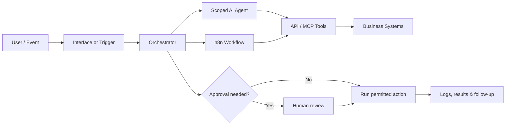

# Kevin Doherty

### AI Systems Engineer & Automation Architect | EDGE | AGENCY

I design and build practical AI systems that connect agents, APIs, and business operations. My work spans **AI agents and multi-agent orchestration, n8n automation, MCP servers, API integrations, developer productivity tools, and full-stack applications**—with a focus on clear interfaces, bounded actions, and systems people can understand and operate.

I’m interested in roles including **AI Automation Engineer, Solutions Engineer, and Developer Productivity Engineer**. I bring product-minded engineering from problem framing through implementation, integration, and documentation.

[Portfolio](https://edgeagency.pro) · [Projects](https://github.com/EdgeAgent?tab=repositories) · [Contact via EDGE | AGENCY](https://edgeagency.pro)

## What I build

| Focus | Selected projects | Engineering emphasis |
| --- | --- | --- |
| **AI agents & orchestration** | [JARVIS Department Agent](https://github.com/EdgeAgent/jarvis-department-agent), [ClawPilot](https://github.com/EdgeAgent/clawpilot-command-center) | FastAPI services, bounded agent roles, approval gates, tool and workflow contracts |
| **Automation architecture** | [EDGE Automation Portfolio](https://github.com/EdgeAgent/edge-automation-portfolio), [Flagship n8n Automations](https://github.com/EdgeAgent/EDGE-AGENCYAutomations-n8n) | Reusable workflow blueprints, API integrations, human review points, operational handoffs |
| **MCP & API integrations** | [GHL Pro MCP](https://github.com/EdgeAgent/ghl-pro-mcp), [API Scout](https://github.com/EdgeAgent/api-scout) | Tool interfaces, service integration, API discovery, structured data exchange |
| **Developer & browser tools** | [Client API Vault Relay](https://github.com/EdgeAgent/client-api-vault-relay-chrome-extension), [Threadlight](https://github.com/EdgeAgent/threadlight-chrome-extension) | Chrome Manifest V3, local-first design, explicit permissions, secure integration patterns |
| **Search & workflow infrastructure** | [EDGE / SEARCHER](https://github.com/EdgeAgent/n8n-automations) | Stable API contracts, n8n-ready outputs, observability and practical operator UX |

## Technical skills

**AI & agents:** OpenAI APIs, tool-using agents, multi-agent systems, prompt and workflow design, human-in-the-loop controls  
**Automation & integration:** n8n, MCP servers, REST APIs, webhooks, OAuth/API integrations, CRM and SaaS workflows  
**Languages & application development:** Python, TypeScript, JavaScript, FastAPI, full-stack web development  
**Infrastructure & delivery:** Docker, GitHub Actions, cloud infrastructure, CI/CD, Git, Linux  
**Developer tools:** Chrome extensions (Manifest V3), command-line tools, API tooling, documentation and testing

## Architecture approach

I aim for systems with understandable boundaries: a user or event enters through an interface or trigger; application services coordinate narrowly scoped agents and integrations; external systems are accessed through explicit API or MCP contracts; and sensitive or consequential actions can pause for review. Logging and useful documentation make the workflow easier to debug and hand off.

## Start here

- **Automation patterns:** browse the [73+ workflow portfolio](https://github.com/EdgeAgent/edge-automation-portfolio). Clone the repository, choose a workflow under `workflows/`, import its JSON into n8n, configure the required credentials in n8n, then test with representative data before activating.
- **Flagship systems:** explore [EDGE-AGENCYAutomations-n8n](https://github.com/EdgeAgent/EDGE-AGENCYAutomations-n8n). Clone the repo, select a documented workflow, import the JSON into your n8n instance, add its service credentials, and validate triggers and approval steps before enabling production runs.
- **Agent service:** see [JARVIS Department Agent](https://github.com/EdgeAgent/jarvis-department-agent) for a FastAPI-based agent service with bounded department managers and approval gates; follow that repository’s README for environment setup and local run instructions.

Project-specific runtime requirements, environment variables, and deployment steps are documented in each repository. Never commit credentials; use your platform’s secrets or credential store. Confirm integrations and operational safeguards in a test environment before connecting live systems.

## How I work

I value useful software over inflated claims: explicit capabilities, understandable architecture, scoped permissions, reviewable actions, observable behavior, and setup instructions that help another developer reproduce the result. I’m comfortable translating between technical teams and operational stakeholders, then delivering a working, maintainable implementation.

---

*Building useful systems at the intersection of AI, automation, and developer experience.*
